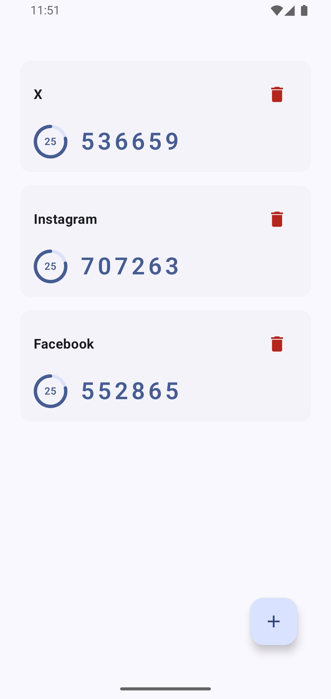
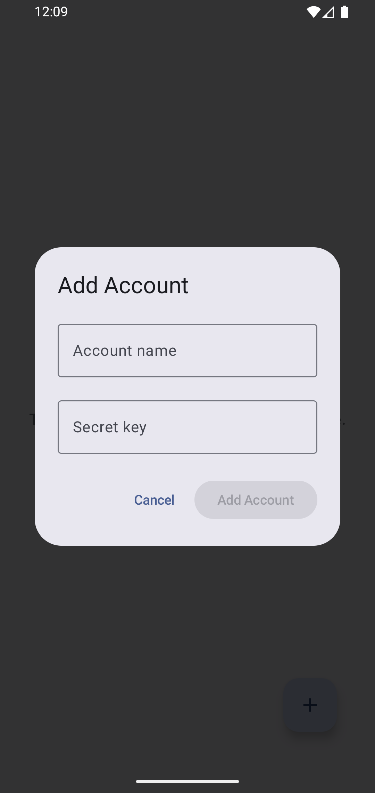
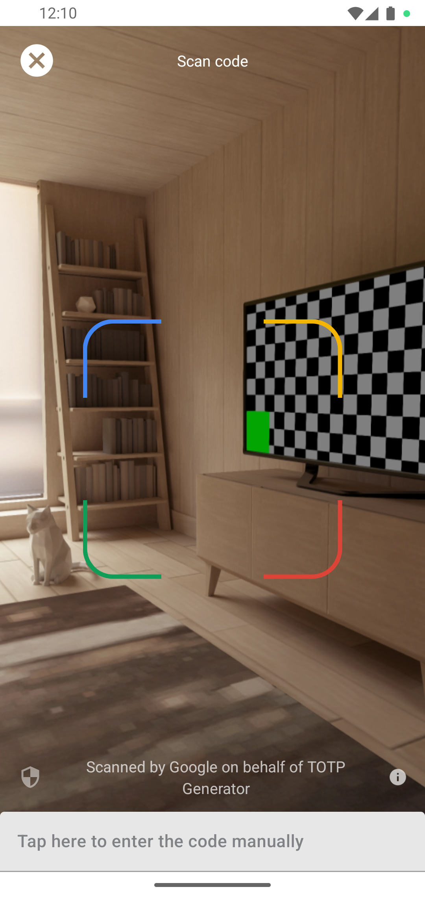

# TOTP Generator for Android

An Android application built with **Jetpack Compose** and **Material 3 Expressive UI** that generates Time-based One-Time Passwords (TOTP) following **RFC 6238** and **RFC 4226** standards.

---

## 📸 Screenshots

| Home Screen | Add Account | QR Code Scanner |
| :---: | :---: | :---: |
|  |  |  |

---

## 🧮 TOTP Algorithm Implementation

The token generation logic resides in [`TotpCalculator.kt`](app/src/main/java/com/segunfrancis/totpgenerator/TotpCalculator.kt) and [`Base32.kt`](app/src/main/java/com/segunfrancis/totpgenerator/Base32.kt). It strictly adheres to **RFC 6238** (Time-Based One-Time Password Algorithm) and **RFC 4226** (HOTP).

```
                      +-------------------+
                      |   Base32 Secret   |
                      +---------+---------+
                                |
                         Base32 Decoding
                                |
                                v
+------------------+   +-------------------+
|  Unix Timestamp  |   |    Secret Bytes   |
+--------+---------+   +---------+---------+
         |                       |
  Time Step (/ 30s)              |
         |                       |
   Time Counter                  |
  (8-byte Big Endian)            |
         |                       |
         +-----------+-----------+
                     |
               HMAC-SHA1 Hash
                     |
             Dynamic Truncation
                     |
               4-Byte Integer
                     |
               Modulo 10^digits
                     |
                     v
             +---------------+
             | 6-Digit Code  |
             +---------------+
```

### Step-by-Step Breakdown

#### 1. Base32 Decoding (`Base32.kt`)
Secrets provided by identity providers are Base32 encoded strings using standard alphabet `A-Z` and `2-7`.
- Input string is cleaned of formatting characters and normalized.
- Each character maps to a 5-bit integer.
- 5-bit chunks are shifted into an 8-bit byte buffer and emitted as a `ByteArray`.

#### 2. Time Counter Calculation
The current Unix timestamp in seconds is divided by the time step window $T_0$ (default $30$ seconds):

$$T = \lfloor \frac{\text{CurrentUnixTime}}{\text{TimeStepSeconds}} \rfloor$$

The 64-bit time counter $T$ is packed into an 8-byte big-endian byte array using `ByteBuffer.allocate(8).putLong(T)`.

#### 3. Cryptographic Hash (HMAC-SHA1)
The secret byte array and 8-byte time counter are passed into an **HMAC-SHA1** hash function:

$$\text{Hash} = \text{HMAC-SHA1}(\text{SecretBytes}, \text{TimeBytes})$$

#### 4. Dynamic Truncation
To convert the 20-byte HMAC-SHA1 hash into a shorter, human-readable code:
1. **Offset Index**: Read the lowest 4 bits (nibble) of the last byte of the hash:
   $$\text{offset} = \text{Hash}[19] \ \& \ \text{0x0F}$$
2. **4-Byte Extraction**: Extract 4 bytes starting at `offset`, ignoring the most significant bit (to avoid signed 32-bit integer issues):
   $$\text{Binary} = ((\text{Hash}[\text{offset}] \ \& \ \text{0x7F}) \ll 24) \ |\ ((\text{Hash}[\text{offset}+1] \ \& \ \text{0xFF}) \ll 16) \ |\ ((\text{Hash}[\text{offset}+2] \ \& \ \text{0xFF}) \ll 8) \ |\ (\text{Hash}[\text{offset}+3] \ \& \ \text{0xFF})$$

#### 5. Modulo Scaling & Zero Padding
The extracted 31-bit integer is scaled down using modulo $10^{\text{digits}}$ (default $10^6 = 1,000,000$):

$$\text{OTP} = \text{Binary} \pmod{10^{\text{digits}}}$$

The result is padded with leading zeros if shorter than requested length (e.g. `"024519"`).

---

## ✨ Features

- 🔐 **RFC 6238 Compliant TOTP Engine**: Pure Kotlin implementation of Base32 decoding and TOTP calculation.
- 📷 **Google Code Scanner**: Integrated Google Play Services Code Scanner (`GmsBarcodeScanning`) for scanning `otpauth://totp/...` QR codes without requiring manual camera permissions.
- 🔗 **RFC Key URI Parser**: `OtpAuthParser` parses standard `otpauth://totp/Label?secret=...` URIs with `URLDecoder` support, properly resolving account names, issuers, periods, and digits.
- 🎨 **Material 3 Expressive UI**: Features Compose Material 3 Expressive Floating Action Menu (`FloatingActionButtonMenu`, `ToggleFloatingActionButton`).
- ⏱️ **Real-time Countdown & Dynamic Urgency**: Circular progress ring glides continuously per-frame. When remaining time is $\le 5$ seconds, colors dynamically switch to error/red state.
- 📋 **One-Tap Copy to Clipboard**: Tapping an account card copies the code to system clipboard with Toast feedback.
- 💾 **Session-Based Local Database**: In-memory `LocalDatabase` backed by `MutableStateFlow` updates UI reactively and prepends newly added accounts at the top.

---

## 🛠️ Tech Stack & Architecture

- **Language**: Kotlin 2.2+
- **UI Framework**: Jetpack Compose (Material 3 Expressive)
- **Architecture**: MVVM with `StateFlow` and `viewModelScope`
- **Scanning**: Google Play Services Code Scanner (`com.google.android.gms:play-services-code-scanner`)
- **Async & Reactive**: Kotlin Coroutines & Flows
